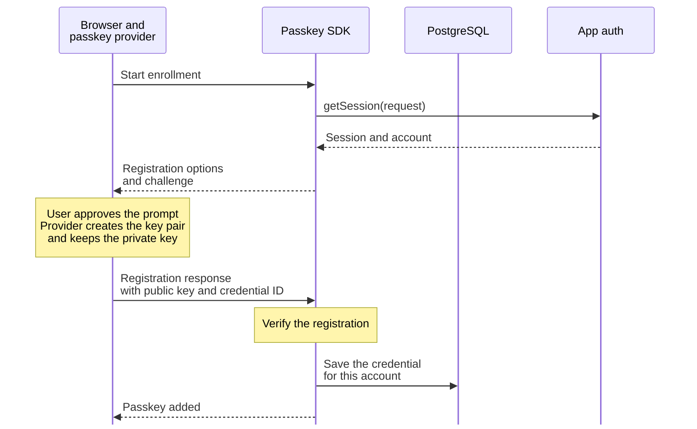
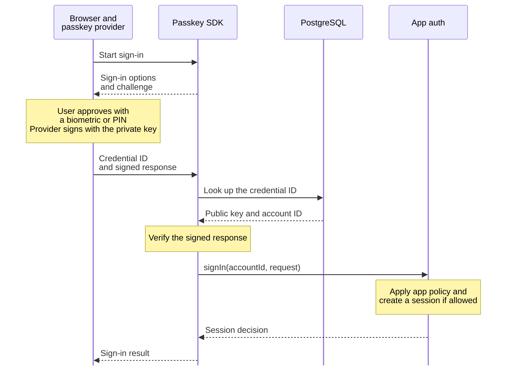

# Next Passkey WebAuthn

Add passkey sign-in to a Next.js App Router app that uses PostgreSQL. Users can add a passkey from account settings, sign in with it on their next visit, and rename or remove it later.

The SDK verifies passkeys with WebAuthn, stores credentials in PostgreSQL, and provides React components for sign-in and account settings. It plugs into your existing accounts, sessions, and sign-in policy. Keep your current sign-in and recovery options available for anyone who loses a passkey or chooses not to use one.

## Get started

Use Node.js 20 or later, or a newer version if your Next.js release requires it. Install the SDK from your app directory.

```sh
npm install next-passkey-webauthn@^0.3.1
```

The quickstart covers the database migration, the three route hooks, and the React components. The example app shows the full flow. [Quickstart](docs/quickstart.md) · [Next.js example](https://github.com/shaoxuan0916/next-passkey-webauthn/tree/main/examples/next-basic)

**Upgrading from 0.1.x or 0.2.x?** Version 0.3.0 uses a new database schema. Users need to add their passkeys again, so make sure they can still sign in or recover their accounts before you switch. [Upgrade instructions](docs/quickstart.md#upgrading-from-01x-or-02x) · [0.3.0 release notes](https://github.com/shaoxuan0916/next-passkey-webauthn/blob/main/docs/releases/v0.3.0.md)

### Use a coding agent

Paste this prompt into a coding agent that has access to your app. Attach the quickstart if it needs a copy. [Quickstart](docs/quickstart.md)

```text
Add next-passkey-webauthn 0.3.0 or later to this Next.js App Router app. It uses PostgreSQL. Follow docs/quickstart.md from the package. Use the version I provide if I attach a compatible tarball.

1. Read the repo instructions and find the existing authentication, session, and database migration code. Follow the quickstart's upgrade instructions if the app uses 0.1.x or 0.2.x. If the app or package is incompatible, stop before changing authentication and tell me what is blocked.
2. Add the PostgreSQL migration to the existing migration workflow. Apply it to a development database if one is available and preserve existing data.
3. Set up the passkey route with the app's trusted session reader, sign-in policy, and session issuer. Use the configured origin and RP ID. Follow the HTTPS rate limit and ingress guidance. Use permanent account IDs and connect passkey cleanup to account deletion. Ask me for production values or hooks if the repo does not supply them.
4. Add PasskeySignIn alongside the current sign-in form and PasskeySettings to the signed-in account area. Enable autofill if the form supports it. Keep the existing sign-in and recovery methods available.
5. Run the app's checks. In a local browser, sign in with the existing method, add a passkey, sign out, and sign in with the passkey. Check that you can list, rename, and revoke it. Test that it no longer works after revocation and that the original sign-in method still works. Use the app's test setup or a virtual WebAuthn authenticator and report what you verified.

Use the SDK for WebAuthn verification, challenges, and passkey storage. Keep the work in development unless I approve production changes.
```

## How passkeys work

A passkey uses a private key held by the user's passkey provider, such as a password manager or security key. The SDK stores the matching public key in PostgreSQL. For each enrollment or sign-in, the SDK issues a fresh random value called a challenge. The challenge can be used once and expires after five minutes.

### Add a passkey

The user starts in their signed-in account settings. Adding or revoking a passkey requires authentication within the last 10 minutes.



### Sign in with a passkey

The user can start without entering a username. The SDK uses the credential ID to find the account and public key. It checks the signature, challenge, origin, and relying-party ID (RP ID) before handing the account ID to your app. On supported browsers, users can also select a passkey from the username or email field if you enable autofill.



The origin identifies the site by scheme, hostname, and port. The RP ID is the domain that scopes the passkey. For `https://app.example.com`, you can set the RP ID to `app.example.com`. Keep the RP ID stable across deployments. [Origin and RP ID setup](docs/quickstart.md#2-add-the-passkey-route)

### Replace or recover a passkey

When replacing a security key, users can add and test the new one before removing the old one. If they lose their only passkey, they can use your recovery flow to regain access, add a replacement, and revoke the lost credential. Revoking a passkey prevents future sign-ins with it. Your app's session policy still controls active sessions.

## Contributing and support

[Contribution guide](CONTRIBUTING.md) · [Report an issue](https://github.com/shaoxuan0916/next-passkey-webauthn/issues) · [MIT license](LICENSE)
