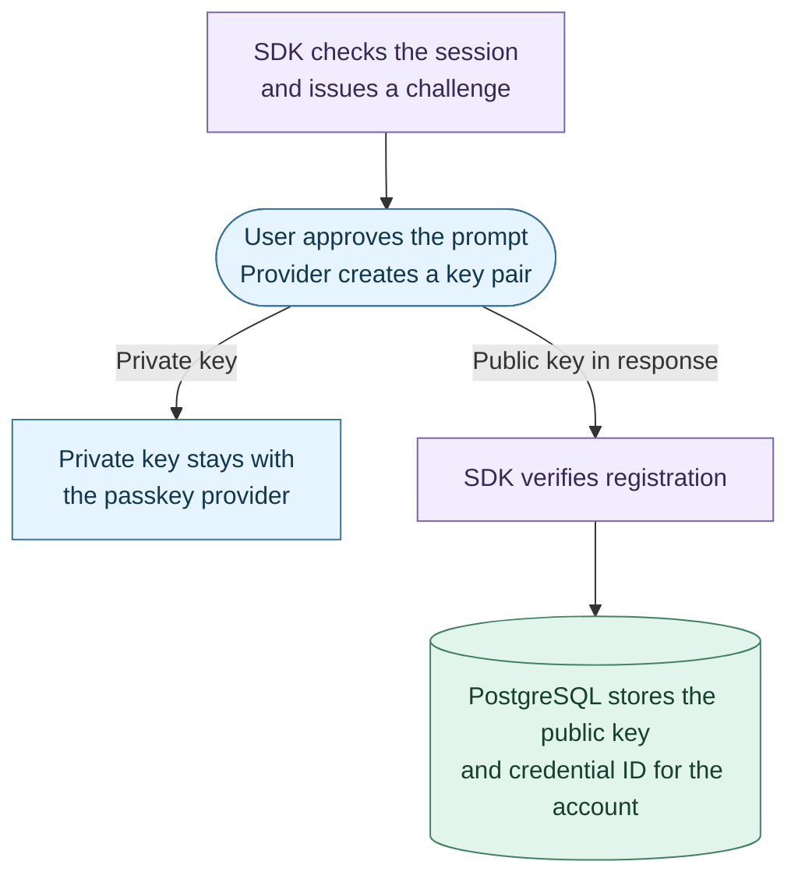
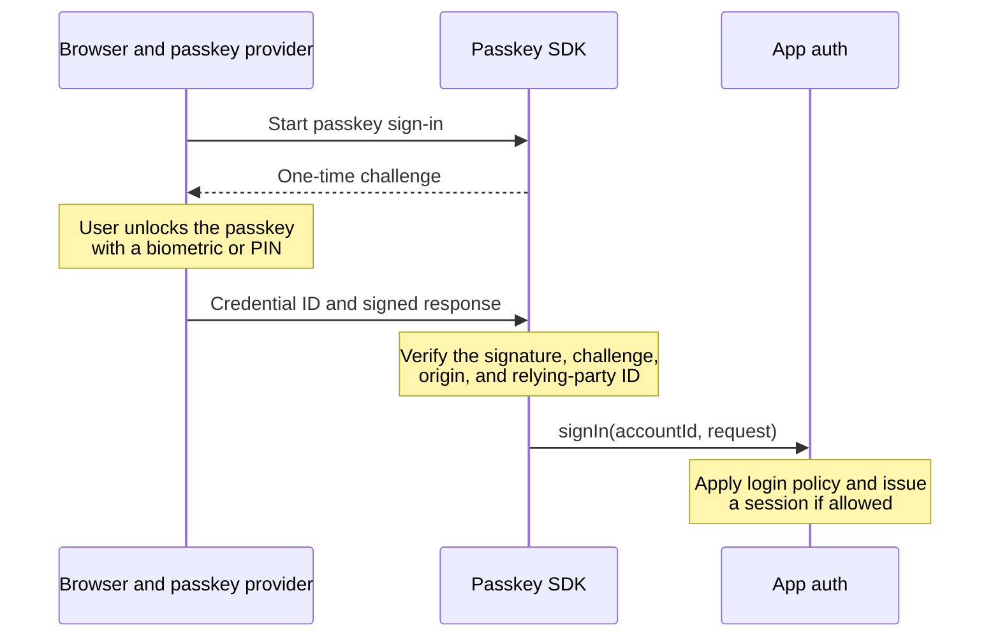

# Next Passkey WebAuthn

Add passkey enrollment, sign-in, and credential management to an existing Next.js App Router app with PostgreSQL. The SDK provides the route handler, database migration, WebAuthn verification, browser client, and React controls. Your app owns accounts, sessions, sign-in policy, and recovery.

Use Node.js 20 or later and meet the minimum Node.js version required by your app's Next.js release.

**The project has retired 0.1.x and 0.2.x. Use 0.3.0 or later.** Existing integrations must preserve a working sign-in or recovery method so users can re-enroll their passkeys. [Upgrade instructions](docs/quickstart.md#upgrading-from-01x-or-02x) · [v0.3.0 release notes](https://github.com/shaoxuan0916/next-passkey-webauthn/blob/main/docs/releases/v0.3.0.md)

## Install manually

The quickstart covers npm installation and connecting PostgreSQL and your app's session system. [Quickstart](docs/quickstart.md)

## Install with your agent

Paste this prompt into a coding agent with access to your target app. Attach the quickstart if the agent needs a copy. [Quickstart](docs/quickstart.md)

```text
Add next-passkey-webauthn 0.3.0 or later to this existing Next.js App Router app with PostgreSQL.

Inspect the repository's instructions, package manager, routes, database migrations, existing login and recovery flow, and server session API. Install a published version at or above 0.3.0, or use the 0.3.0 tarball I provide. Follow docs/quickstart.md from the installed package, including its upgrade instructions for 0.1.x and 0.2.x. If a compatible package or app stack is unavailable, report the blocker before changing auth.

1. Add the packaged PostgreSQL migration to this app's migration workflow. Apply it to a development database when available. Preserve existing data.
2. Mount createNextPasskeys at an App Router route and connect its PostgreSQL store, trusted session reader, and session issuer. Keep the app's login policies and fallback. Use the configured app origin and RP ID, with localhost for development. For HTTPS, configure the request and operation rate limits and ingress deadlines from the quickstart. Use account IDs that are never reassigned and connect passkey cleanup to account deletion. Flag any production values or hooks that need input instead of guessing them.
3. Add PasskeySignIn alongside the current login flow and PasskeySettings in the signed-in account area. Fit both to the app's navigation. Enable autofill when the login form can support it.
4. Run the app's checks. In a local browser, enroll after signing in normally, sign out, sign in with the passkey, and then list, rename, and revoke it. Confirm that the revoked passkey can no longer sign in and that the original login still works. Use the app's test setup or a virtual WebAuthn authenticator. Report the checks you ran and any checks that remain.

Keep verification, challenge handling, and storage in the SDK. Derive account identity from the trusted session hooks. Keep the changes local to development unless I explicitly authorize production changes.
```

## How passkeys work

### Add a passkey in account settings

Enrollment starts with an existing account. The SDK uses `getSession` to identify the account and requires a sign-in within the last 10 minutes. The user's passkey provider keeps the private key. Your app stores the public key so it can verify future sign-ins.



#### Connect your existing session

Pass `getSession` to `createNextPasskeys`. Replace `readActiveSession` with your app's server-side helper that validates the request and returns the active session, or `null` if the user is signed out.

```ts
import type { PasskeySession } from "next-passkey-webauthn/next";
import { readActiveSession } from "@/lib/auth";

async function getSession(request: Request): Promise<PasskeySession | null> {
  const session = await readActiveSession(request);
  if (!session) return null;

  return {
    id: session.id,
    account: { id: session.user.id, name: session.user.email },
    authenticatedAt: session.lastAuthenticatedAt.getTime(),
  };
}
```

Use an opaque session ID that stays stable across requests and rotates on sign-in or reauthentication. Use a permanent, never-reassigned user ID for `account.id`. An email or username works for `account.name`, and `account.displayName` is optional. The example converts a server-verified `Date` to epoch milliseconds for `authenticatedAt`. Preserve that time on routine session refreshes.

### Sign in on a return visit

The user can start without typing a username. The credential ID tells the SDK which public key to load from PostgreSQL. A valid signature proves the user approved this fresh challenge with the matching passkey. Your app then decides whether to issue its usual session.



## Use cases

| When | User journey | Result |
| --- | --- | --- |
| An existing customer wants faster sign-in | Usual login → account settings → **Add a passkey** | On the next visit, they can use **Sign in with a passkey**. |
| A returning customer uses autofill | Focus the username field → choose a suggested passkey → approve | A supported browser can start sign-in from the existing form when autofill is enabled. |
| A team member replaces a security key | Sign in with the old key → add the new key → test it → revoke the old key | The old credential can no longer sign in. Existing sessions follow the app's session policy. |
| A customer loses their only passkey | Use the app's recovery flow → sign in again → enroll a replacement → revoke the lost credential | The customer regains passkey access to the same account. |

## Contributing and support

Try the reference app, contribute a change, or report an issue. [Reference app](https://github.com/shaoxuan0916/next-passkey-webauthn/tree/main/examples/next-basic) · [Contributing](https://github.com/shaoxuan0916/next-passkey-webauthn/blob/main/CONTRIBUTING.md) · [Issues](https://github.com/shaoxuan0916/next-passkey-webauthn/issues) · [MIT license](LICENSE)
